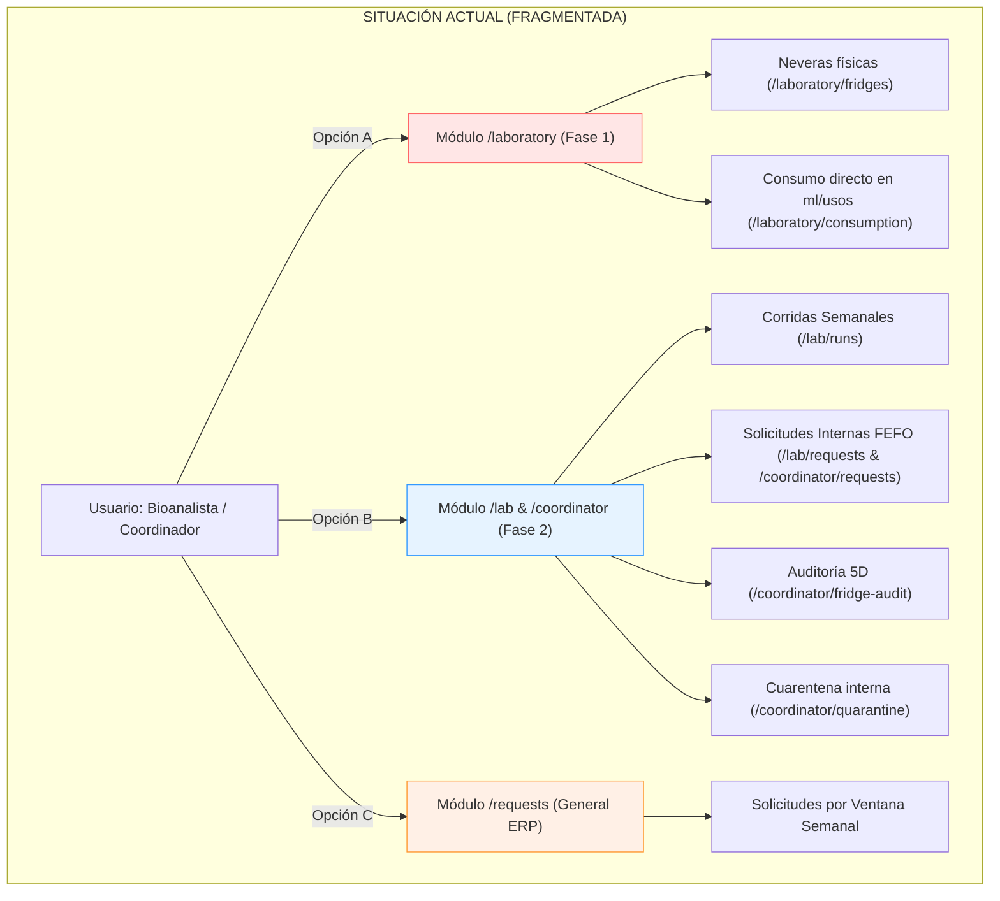
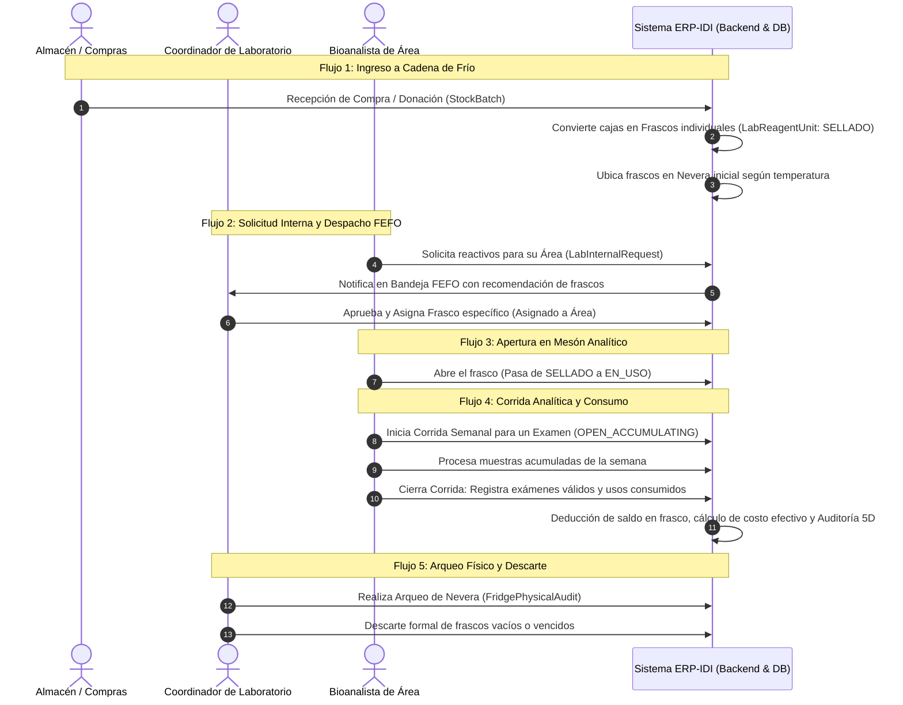
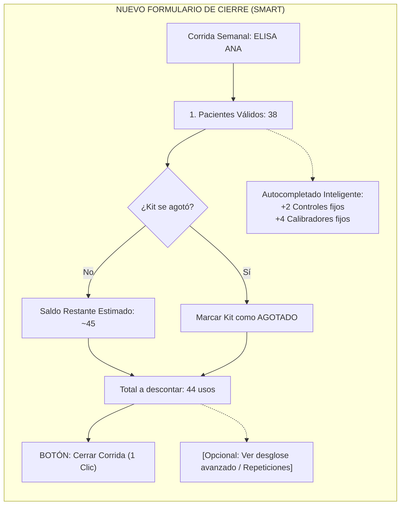

# MÓDULO DE LABORATORIO CLÍNICO & CADENA DE FRÍO (ERP-IDI)
## Documento Maestro de Arquitectura, Flujos Operativos, Diagnóstico y Propuestas de Simplificación

> **Institución**: Instituto de Inmunología "Dr. Nicolás E. Bianco Colmenares" (IDI - UCV)  
> **Sistema**: ERP-IDI v2.5 (Gestión Hospitalaria, Almacén, Cadena de Frío e Investigación)  
> **Propósito del documento**: Servir como especificación técnica completa y base de discusión para que el equipo técnico y agentes de IA analicen el funcionamiento actual, identifiquen sobre-ingeniería o fricciones de UX, y acuerden una simplificación elegante sin perder rigor clínico ni trazabilidad.

---

## 1. OBJETIVO GENERAL Y ALCANCE CLÍNICO

### 1.1 ¿Qué problema del mundo real resuelve este módulo?
El Instituto de Inmunología opera tanto como **centro asistencial de diagnóstico de alta especialidad** (inmunología clínica, autoinmunidad, citometría de flujo, virología, inmunogenética) como **centro de investigación científica y docencia universitaria**.

En este entorno, los reactivos de laboratorio presentan particularidades que un inventario comercial ordinario no puede manejar:
1. **Cadena de Frío Estricta**: Los reactivos (anticuerpos monoclonales, conjugados enzimáticos, sustratos, cebadores) se inactivan o desnaturalizan si pierden refrigeración (2°C a 8°C) o congelación (-20°C a -80°C).
2. **Fraccionamiento y Usos Teóricos vs. Reales**: Un kit diagnóstico no se consume como "1 unidad". Una caja contiene un kit de, por ejemplo, **96 determinaciones (pozos)**. Sin embargo, un kit **nunca rinde 96 pacientes** porque cada corrida analítica exige gastar pozos en:
   - Calibradores (curva estándar).
   - Controles de calidad (control positivo, control negativo).
   - Repeticiones por muestras dudosas o valores críticos.
   - Volumen muerto / purga de pipetas.
   El rendimiento real suele ser de 80 a 86 pacientes por kit de 96 pruebas.
3. **Segregación Clínico-Asistencial vs. Investigación (I+D)**: El hospital atiende pacientes del sistema de salud y al mismo tiempo ejecuta proyectos de tesis y subvenciones científicas (FONACIT, OPS, etc.). Los reactivos de investigación no pueden ser usados arbitrariamente en rutina clínica y viceversa, para evitar fraude presupuestario y desabastecimiento asistencial.
4. **Agrupación en Corridas Semanales**: Por costo y estabilidad de los reactivos reconstituidos, los análisis inmunológicos no se procesan muestra por muestra a medida que llegan. Las muestras de suero o plasma se acumulan durante la semana y se procesan en **corridas semanales en bloque** (batch testing) los días asignados.

---

## 2. DIAGNÓSTICO DEL SISTEMA ACTUAL: LA "DOBLE IDENTIDAD" Y FRAGMENTACIÓN

### 2.1 El conflicto de rutas y pantallas
Actualmente existen en el código **dos arquitecturas paralelas** que coexisten para el mismo laboratorio, lo que genera confusión total en el usuario y en el desarrollador:

| Concepto | Implementación Original ("Fase 1") | Implementación Nueva ("Fase 2 - Workflow") | Consecuencia / Conflicto |
| :--- | :--- | :--- | :--- |
| **Rutas Frontend** | `/laboratory/consumption`<br>`/laboratory/fridges` | `/lab/dashboard`<br>`/lab/runs`<br>`/lab/requests`<br>`/coordinator/*` | Dos menús distintos en el sidebar. El analista no sabe si debe ir a "Laboratorio Clínico" o a "Consumo de Reactivos" en Almacén. |
| **Mecanismo de Consumo** | **Consumo Volumétrico Rápido**: El usuario selecciona un frasco, escribe "5 ml" o "10 determinaciones", elige un protocolo genérico y descuenta. | **Motor de Corridas Semanales**: El usuario crea una corrida, acumula pacientes, y al cerrar debe completar un formulario complejo de 8 variables matemáticas por kit consumido. | Si el analista usa el consumo directo, el sistema no sabe qué examen se hizo ni cuántos pacientes se atendieron. Si usa la corrida, el proceso es excesivamente pesado. |
| **Solicitud de Reactivos** | Solicitudes Generales de Almacén (`/requests`) con despachos en Kardex general. | Solicitudes Internas de Laboratorio (`/lab/requests`) con sugerencia algorítmica FEFO y asignación a área. | ¿Por dónde pide un reactivo un bioanalista? ¿Por `/requests` o por `/lab/requests`? Hay dos bandejas independientes y dos modelos (`Request` vs `LabInternalRequest`). |
| **Matriz de Permisos** | `/laboratory/consumption` y `/laboratory/fridges` exigen rol `LABORATORIO` o `ADMINISTRADOR`. | `/lab/runs` y `/lab/requests` permiten `BIOANALISTA`, `COORDINADOR_LABORATORIO`, `COORDINADOR`. | Un usuario con rol `BIOANALISTA` puede cerrar corridas complejas pero el sistema le bloquea el acceso a ver las neveras o hacer consumos directos. |



---

## 3. ARQUITECTURA DE DATOS: MODELOS Y RELACIONES EN PRISMA

El sistema cuenta con una estructura de datos sólida en `backend/prisma/schema.prisma`. El problema no es la base de datos, sino la experiencia de usuario y la falta de cohesión en las pantallas.

### 3.1 Diccionario de Modelos Clave

1. **`Fridge`**: Representa las neveras, cavas o congeladores físicos del instituto (ej. "Nevera Inmuno 01", "Cava Principal -20°C"). Registra `targetTempCelsius` (ej. 4.00°C) y estado operativo (`OPERATIVO`, `MANTENIMIENTO`, etc.).
2. **`LabReagentUnit`**: Es el **frasco, vial o caja individual física**.
   - `unitCode`: Identificador único (ej. `LOTE2026-F01`).
   - `initialTheoreticalUses`: Total de determinaciones teóricas de fábrica (ej. 96).
   - `remainingUses`: Saldo restante en pozos/usos en tiempo real.
   - `status`: `SELLADO` (en frío sin abrir), `EN_USO` (abierto en mesón analítico), `INTERNAL_QUARANTINE` (bloqueado por sospecha técnica), `AGOTADO`, `DESCARTADO`.
   - `ownershipType`: `CLINICAL_ROUTINE` (asistencial) o `RESEARCH_PROJECT` (exclusivo de un proyecto científico).
   - `unitCostPerUse`: Costo unitario por determinación (costo caja / usos teóricos).
   - `assignedLabAreaId`: Área a la que pertenece actualmente el frasco.
3. **`LabStockMovement`**: Bitácora física de cada vial: movimientos de tipo `CONSUMO_PRUEBAS`, `TRASLADO_NEVERA`, o `DESCARTE`.
4. **`LabArea` y `UserLabArea`**: Áreas especializadas del laboratorio (ej. *Inmunogenética*, *Inmunopatología*, *Citometría de Flujo*, *Alergias*). Controla a qué reactivos y exámenes tiene acceso cada bioanalista.
5. **`LabExam`**: Catálogo de exámenes que realiza el laboratorio (ej. *Anticuerpos Antinucleares ANA*, *Cuantificación de IgE*, *Subpoblaciones Linfocitarias CD4/CD8*). Se relaciona con los productos compatibles mediante `LabExamProduct`.
6. **`LabInternalRequest` y `LabInternalRequestItem`**: Pedido interno de insumos donde el bioanalista pide determinaciones/frascos a la Coordinación. La Coordinación cuenta con un algoritmo FEFO (First Expired, First Out) que sugiere qué frasco exacto entregar.
7. **`LabWeeklyRun`**: Cabecera de la corrida semanal. Agrupa la técnica analítica, el examen, el bioanalista responsable y la semana de trabajo.
8. **`LabRunConsumption`**: Desglose técnico de consumo en la corrida para cada kit utilizado:
   - `patientUses`: Determinaciones válidas de pacientes.
   - `repeatUses`: Repeticiones técnicas con motivo (`CALIBRATION_FAILURE`, `CRITICAL_VALUE_CONFIRMATION`, etc.).
   - `calibratorUses`: Pozos gastados en curva de calibración.
   - `controlUses`: Pozos gastados en controles de calidad (+ / -).
   - `wasteUses`: Merma técnica / purga.
   - `externalCalibratorUnitId`: Frasco secundario si el calibrador viene en vial separado del kit.
9. **`LabConsumptionAuditLog`**: Registro inmutable de auditoría en 5 dimensiones (`PATIENT`, `REPEAT`, `CALIBRATION`, `CONTROL`, `WASTE`, `YIELD_SURPLUS`, `YIELD_DEFICIT`).
10. **`FridgePhysicalAudit`**: Arqueo físico periódico de neveras para conciliar saldo de frascos y detectar desviaciones.

---

## 4. LOS 5 FLUJOS OPERATIVOS DEL LABORATORIO (CÓMO DEBERÍA FUNCIONAR)



### Detalle paso a paso de cada flujo:

#### Flujo 1: Recepción e Ingreso a Nevera (Almacén -> Cadena de Frío)
1. **Entrada de material**: El almacén recibe una orden de compra o donación de reactivos (ej. 5 cajas de *ELISA Anti-DNA de 96 pruebas*).
2. **Generación de unidades (`LabReagentUnit`)**: El sistema calcula `initialTheoreticalUses = 5 cajas * 96 pruebas = 480 usos`.
3. **Identificación física**: Cada caja/frasco recibe su código de barras único (ej. `LOT-DNA-01`, `LOT-DNA-02`...) con estado inicial `SELLADO`.
4. **Asignación a Nevera**: Se ingresan en la nevera correspondiente (ej. Nevera 02 a 4°C).

#### Flujo 2: Solicitud de Reactivos y Despacho FEFO (Área -> Coordinación)
1. El bioanalista del área de Inmunopatología necesita reactivos para su plan de trabajo semanal.
2. Crea una solicitud indicando qué examen/producto necesita y cuántas determinaciones o frascos estima requerir.
3. El Coordinador de Laboratorio ve la solicitud en su bandeja. El sistema ejecuta el algoritmo FEFO:
   - *Regla 1*: Busca si ya hay un frasco `EN_USO` asignado a esa área con saldo suficiente.
   - *Regla 2*: Si no hay ninguno, sugiere el frasco en estado `SELLADO` cuya fecha de vencimiento sea la más próxima (`expirationDate ASC`).
   - *Regla 3*: Valida que el frasco pertenezca a `CLINICAL_ROUTINE` (no investigación).
4. El coordinador aprueba y el frasco queda asignado al área.

#### Flujo 3: Apertura de Frasco / Vial
1. En el momento en que el bioanalista saca el frasco de la nevera para iniciar los ensayos, cambia su estado de `SELLADO` a `EN_USO`.
2. Se registra la fecha y hora de apertura (`openedAt`) y el usuario que lo abrió (`openedById`).
3. *Regla de Calidad*: A partir de la fecha de apertura, algunos reactivos tienen estabilidad reducida (ej. 30 días post-apertura aunque el lote venza en un año).

#### Flujo 4: Corrida Semanal y Cierre con Deducción de Usos
1. **Apertura de Corrida**: Se abre una corrida semanal para el examen (ej. `RUN-2026-0042` para *ANA por Inmunofluorescencia*).
2. **Acumulación de Pacientes**: Durante la semana, los pacientes atendidos que requieren dicho examen se cargan a la corrida.
3. **Cierre de Corrida**: Al finalizar el lote analítico, el bioanalista reporta:
   - Número de pacientes válidos diagnosticados (ej. 38 pacientes).
   - Usos consumidos del kit principal:
     - 38 pruebas de pacientes.
     - 4 pozos de curva de calibración.
     - 2 pozos de control de calidad.
     - 2 repeticiones (ej. 1 muestra lipémica y 1 confirmación de valor crítico positivo fuerte).
     - 2 pozos de merma/espacio muerto.
     - Total descontado del kit: 48 usos.
4. **Conciliación de Rendimiento (Yield Variance)**:
   - **Caso Normal**: El frasco tenía 96 usos, se descuentan 48, quedan 48 usos.
   - **Over-yield (Rendimiento superior)**: El bioanalista sacó más pruebas de las teóricas. El sistema no bloquea la operación; absorbe el excedente en `yieldVariance` positivo y genera un log de `YIELD_SURPLUS` con costo 0.
   - **Sub-yield / Agotamiento prematuro**: El reactivo se agotó físicamente antes de lo previsto (ej. se acabaron las tiras o hubo burbujas). El bioanalista marca "Kit Agotado Físicamente"; el saldo restante se ajusta a 0 y la diferencia se registra como `YIELD_DEFICIT`.
5. **Cálculo de Costo Efectivo por Paciente**:
   $$\text{Costo Total Corrida} = (\text{Total Usos Deducidos}) \times (\text{Costo Unitario por Uso})$$
   $$\text{Costo Efectivo por Examen Válido} = \frac{\text{Costo Total Corrida}}{\text{Total Pacientes Válidos}}$$
   *Impacto clínico*: Las mermas, calibradores y controles se absorben de forma transparente en el costo real del diagnóstico del paciente.

#### Flujo 5: Arqueo Físico, Cuarentena y Descarte
1. **Arqueo Físico Semanal/Mensual**: El coordinador o supervisor audita una nevera física (`/coordinator/fridge-audit`). Revisa visualmente frasco por frasco el saldo real estimado vs. lo que dice el sistema. Si hay discrepancias, registra un ajuste justificado.
2. **Cuarentena Interna**: Si una nevera sufre una falla eléctrica (rotura de cadena de frío) o si los controles de calidad dan fuera de rango 3 desviaciones estándar (Westgard rules), el coordinador envía el frasco/lote a `INTERNAL_QUARANTINE`. Sus usos quedan **bloqueados instantáneamente** en el backend para impedir que se consuman en diagnósticos.
3. **Descarte**: Si el lote se confirma dañado o vence, se ejecuta `discardLabUnit`, cerrando el ciclo de vida del vial.

---

## 5. ERRORES ESPERADOS, CASOS BORDE Y PUNTOS DE FALLA CRÍTICOS

En la práctica clínica hospitalaria ocurren situaciones imprevistas continuas. El sistema debe responder de forma predecible y segura ante cada una:

| # | Evento o Falla Esperada | Causa Raíz en el Laboratorio | Comportamiento Backend Actual | Problema en UX / Riesgo |
| :-: | :--- | :--- | :--- | :--- |
| **E1** | **Kit agotado a mitad de una corrida** | Una placa de 96 pozos se termina procesando la muestra 30 de 40 pacientes acumulados. | `closeWeeklyRun` admite múltiples ítems en `consumptions`. Permite registrar Frasco A (agotado con 30 usos) y Frasco B (con los 10 usos restantes). | En el frontend actual, cambiar de kit en el formulario de cierre es confuso y requiere agregar otra fila manualmente rellenando todos los campos. |
| **E2** | **Reactivo vencido con saldo disponible** | Un frasco tiene 20 usos restantes pero su fecha de vencimiento (`expirationDate`) pasó ayer. | `listAvailableReagents` y el filtro FEFO ordenan por fecha, pero el backend no bloquea de forma rígida si alguien intenta consumir un vencido a menos que esté en estado `VENCIDO`. | Riesgo médico: El sistema debe advertir con un banner rojo bloqueante que el reactivo venció y exigir descarte o autorización de supervisor. |
| **E3** | **Corte eléctrico / Desviación térmica** | Una nevera pasa de 4°C a 18°C durante 6 horas por fallo en la planta eléctrica del instituto. | Existe el modelo `BatchIncident` y la acción `putUnitInQuarantine`. | El bioanalista en el mesón no ve la alerta térmica directamente cuando va a usar el frasco; la cuarentena la gestiona el coordinador en `/coordinator/quarantine`. |
| **E4** | **Confusión de Frascos (Clínico vs Investigación)** | Un bioanalista intenta usar un kit donado específicamente para una tesis de maestría en pacientes de rutina. | **Blindaje total en backend**: `closeWeeklyRun` y `approveInternalRequest` lanzan excepción estricta: `La unidad X es de investigación y no puede consumirse en rutina clínica`. | Excelente seguridad, pero en el frontend el bioanalista debería ver los reactivos de investigación claramente diferenciados (con tag púrpura de I+D) para evitar frustración. |
| **E5** | **Fallo de Calibración / Controles fuera de rango** | El estándar no dio la curva esperada y hay que repetir la corrida entera. | `RepeatReason` enum contempla `CALIBRATION_FAILURE` y `OPERATOR_ERROR`. Los usos se cargan al log como `REPEAT`. | Si falla la corrida entera, el bioanalista tiene que registrar decenas de repeticiones a mano una por una. Debería existir un botón: *"Corrida Fallida por Calibración"*. |
| **E6** | **Discrepancia en Arqueo (Frascos Fantasma)** | Un frasco figura en el sistema en la Nevera 01 pero físicamente está en la Nevera 03 o fue botado sin registrar. | `FridgePhysicalAudit` registra la discrepancia en `FridgePhysicalAuditItem` con estado `PENDING_ADJUSTMENT`. | El flujo de reconciliación posterior al arqueo no está conectado fluidamente con la actualización del inventario en un solo clic. |

---

## 6. PROPUESTA DE SIMPLIFICACIÓN INTEGRAL

Para que el módulo sea intuitivo, fácil de explicar y adoptado con entusiasmo por el personal del IDI, se propone una **reestructuración profunda pero que respeta el 100% de la base de datos existente**:

### Propuesta 1: Unificar la Navegación en un Solo Espacio (`/lab/*`)
Eliminar la duplicidad de rutas en el sidebar. Todo el laboratorio vive bajo un único menú **"Laboratorio Clínico"**:

```
MENÚ UNIFICADO: LABORATORIO CLÍNICO
├── 1. Tablero General de Laboratorio (/lab)
│      - Estado de Neveras y Alertas de Temperatura
│      - Frascos en uso y lotes por vencer (FEFO)
│      - Corridas abiertas de la semana
│
├── 2. Corridas Analíticas & Consumo (/lab/runs)
│      - Lista de corridas activas e históricas
│      - Registro de Corrida + Cierre simplificado (1-Click)
│      - Consumo directo rápido (para pruebas individuales de emergencia)
│
├── 3. Solicitudes de Insumos (/lab/requests)
│      - Vista Bioanalista: "Pedir reactivos para mi área"
│      - Vista Coordinador: "Aprobar con recomendación FEFO"
│
├── 4. Neveras & Cadena de Frío (/lab/fridges)
│      - Visualizador visual de Neveras (temperatura, frascos alojados)
│      - Arqueo físico de saldo
│
└── 5. Calidad & Cuarentena (/lab/quality)
       - Lotes en cuarentena técnica
       - Reporte de incidencias y descartes
```

### Propuesta 2: Simplificación Radical del Formulario de Cierre de Corrida
Actualmente, para cerrar una corrida en `/lab/runs/[id]/close`, el bioanalista debe ingresar manualmente 12 variables por kit.

#### El Modelo "Smart Defaults" (Modo Simple vs. Modo Avanzado):
En el 90% de las corridas de rutina, los calibradores y controles son fijos según el protocolo del fabricante:
- **Modo Simple (Por Defecto)**:
  1. El bioanalista solo ingresa:
     - **Pacientes válidos**: ej. `38`
     - **¿Se terminó el frasco?**: `[No] / [Sí]`
     - **Saldo visual aproximado restante** (opcional): ej. `40 pozos`
  2. El sistema calcula automáticamente los controles estándar del examen (ej. 2 controles + 4 calibradores = 6 usos fijos).
  3. Total deducido = $38 + 6 = 44$ usos.
  4. Botón verde: **"Cerrar Corrida y Descontar"**.

- **Modo Avanzado (Acordeón desplegable para excepciones)**:
  - Solo si hubo repeticiones, fallas técnicas, muestras hemolizadas o frascos secundarios de calibrador, el analista abre el acordeón y especifica los detalles.



### Propuesta 3: Unificación de Solicitudes (Aclarar `/requests` vs `/lab/requests`)
- **Regla Conceptual Clara**:
  - `/requests` (Almacén General): Es para insumos generales de papelería, oficina, limpieza o tubos secos que se piden al almacén central.
  - `/lab/requests` (Cadena de Frío): Es la solicitud técnica de reactivos y kits refrigerados que autoriza la Coordinación de Laboratorio con criterio FEFO.
- En la interfaz de `/lab/requests`, renombrar claramente a: **"Requisición de Reactivos Refrigerados (FEFO)"** para que no haya duda sobre su función.

### Propuesta 4: Ajuste Coherente de Permisos RBAC
Asegurar que el rol `BIOANALISTA`:
- Pueda ver las neveras de su área asignada y el contenido de los frascos.
- Pueda marcar frascos como `EN_USO` al abrirlos.
- Pueda registrar consumos de emergencia o corridas semanales.
- El rol `COORDINADOR_LABORATORIO` mantiene la exclusividad de: aprobar solicitudes FEFO, autorizar salidas de cuarentena y consolidar arqueos físicos.

---

## 7. CUESTIONARIO Y GUÍA DE DEBATE PARA OTROS AGENTES / DESARROLLADORES

Cuando lleves este documento a otros agentes o desarrolladores para diseñar la solución final, somete a votación y discusión los siguientes **puntos de decisión**:

### Pregunta 1: ¿Mantenemos el Consumo Directo o Todo Pasa por Corridas?
* **Opción A (Híbrida - Recomendada)**: Mantener el "Motor de Corridas" para ensayos masivos/semanales (ELISA, Inmunofluorescencia, Citometría) y dejar un "Consumo Rápido Directo" para pruebas rápidas de cassette (ej. prueba rápida de embarazo, HIV rápido) donde no se justifica abrir una corrida semanal.
* **Opción B (Todo por Corridas)**: Forzar que todo consumo pertenezca a una corrida, incluso si la corrida tiene solo 1 paciente.

### Pregunta 2: ¿Cómo manejar los viales de Calibrador Externo?
* En algunas técnicas, el kit de ELISA trae su propio calibrador dentro de la caja. En otras técnicas, el calibrador se compra por separado (frasco independiente).
* **Pregunta**: ¿Conviene mantener la relación `externalCalibratorUnitId` en `LabRunConsumption` o simplificarlo considerando el calibrador como un producto reactivo normal que se descuenta en su propia línea?

### Pregunta 3: ¿Qué nivel de detalle en Repeticiones de Examen es indispensable para el IDI?
* ¿Es necesario que el bioanalista seleccione un `RepeatReason` obligatorio (ej. `CRITICAL_VALUE_CONFIRMATION` vs `OPERATOR_ERROR`) o basta con un campo numérico de repeticiones y una nota de texto libre para no entorpecer el trabajo en horas pico?

### Pregunta 4: ¿Unificación visual inmediata de rutas?
* ¿Estamos de acuerdo en fusionar `/laboratory/*` dentro de `/lab/*`, eliminando las páginas redundantes y actualizando el sidebar?

---

## 8. RESUMEN DE ARCHIVOS AFECTADOS EN EL REPOSITORIO

Para referencia rápida de los desarrolladores y agentes que trabajarán en la simplificación:

| Componente | Archivo Principal | Función Actual |
| :--- | :--- | :--- |
| **Backend Service** | `backend/src/services/lab.service.ts` | Contiene toda la lógica de neveras, unidades, corridas, FEFO y auditoría 5D. |
| **Backend Controller** | `backend/src/controllers/lab.controller.ts` | Controladores REST de todas las operaciones de laboratorio. |
| **Backend Routes** | `backend/src/routes/lab.routes.ts` | Definición de rutas y middlewares de autorización por rol. |
| **Frontend Workflow Service** | `frontend/src/services/lab-workflow.service.ts` | Cliente API de corridas, solicitudes FEFO y áreas. |
| **Frontend Lab Service** | `frontend/src/services/laboratory.service.ts` | Cliente API original de neveras y consumos volumétricos directos. |
---

## 9. ESTADO ACTUAL: ARQUITECTURA UNIFICADA v2.5 (IMPLEMENTADA Y VERIFICADA)

### 9.1 Consolidación y Resolución de la Fragmentación
El Módulo de Laboratorio Clínico ha sido unificado exitosamente bajo una arquitectura limpia y coherente:
1. **Frontend Consolidado en `/lab/*`**:
   - `/lab`: Tablero General de Laboratorio con semáforo de neveras, frascos en uso en mesón, corridas abiertas y alertas FEFO.
   - `/lab/runs`: Gestión de corridas semanales con modal integrado de **Consumo Rápido (Prueba Individual / Emergencia)**.
   - `/lab/runs/[id]/close`: Formulario de cierre inteligente con selección FEFO, Smart Defaults (Modo Simple vs. Avanzado) y soporte de Rollover automático.
   - `/lab/fridges`: Vista unificada de neveras con pestañas para visualizador de frascos alojados y arqueo físico quincenal.
   - `/lab/requests`: Bandeja unificada de requisiciones internas con recomendación FEFO y aprobación técnica.
   - `/lab/quality`: Centro de control de calidad, bitácora de auditoría 5D e incidencias de cuarentena.
2. **Redirecciones y Limpieza Legada**:
   - Rutas legadas `/laboratory/*` y `/coordinator/*` redirigen transparentemente a sus equivalentes unificados bajo `/lab/*`.
   - Navegación del Sidebar unificada en una sola sección accesible según los roles del usuario.

### 9.2 Nuevos Endpoints y Capacidades de Backend (`backend/src/routes/lab.routes.ts`)

| Método | Endpoint | Roles Permitidos | Propósito y Contrato |
| :--- | :--- | :--- | :--- |
| `POST` | `/api/lab/runs/quick-consume` | `BIOANALISTA`, `COORDINADOR_LABORATORIO`, `COORDINADOR`, `ADMINISTRADOR` | Registra consumo unitario de prueba rápida (cassette/urgencia), crea corrida atómica, descuenta pozos y asienta auditoría 5D. Retorna `201 Created`. |
| `POST` | `/api/lab/runs/:id/fail-calibration` | `BIOANALISTA`, `COORDINADOR_LABORATORIO`, `COORDINADOR`, `ADMINISTRADOR` | Asienta falla de calibración técnica (Caso Borde E5), descuenta pozos gastados bajo `REPEAT`, cierra la corrida con 0 pacientes y clona automáticamente una nueva corrida para reproceso. Retorna `200 OK`. |
| `POST` | `/api/lab/fridge-audits/:id/reconcile` | `COORDINADOR_LABORATORIO`, `COORDINADOR`, `ADMINISTRADOR` | Regulariza en 1-clic las discrepancias de arqueo físico (Caso Borde E6), actualiza saldos reales en `LabReagentUnit` y asienta auditoría 5D (`YIELD_DEFICIT` o `YIELD_SURPLUS`). Retorna `200 OK`. |
| `POST` / `PATCH` | `/api/lab/units/:id/open` | `BIOANALISTA`, `COORDINADOR_LABORATORIO`, `COORDINADOR`, `ADMINISTRADOR` | Abre un frasco sellado en mesón (`SELLADO` -> `EN_USO`). Bloquea con `400 Bad Request` si el lote está vencido (`expirationDate < hoy`) o en cuarentena. |

### 9.3 Comandos de Verificación y Testing Automatizado

- **Prueba de Recorrido Completo (E2E Verification & Seed)**:
  ```bash
  pnpm --filter backend run test:lab-e2e
  ```
  *Ejecuta 21 aserciones secuenciales cubriendo desde FASE 0 hasta FASE 6 y deja una semilla activa en la base de datos local para inspección visual en `http://localhost:3000/lab`.*

- **Suite de Pruebas de Integración HTTP y Matriz RBAC**:
  ```bash
  pnpm --filter backend exec vitest run tests/lab-http-e2e.test.ts
  ```
  *Verifica contratos HTTP, códigos de estado (200, 201, 400, 403) y aislamiento de permisos entre Bioanalista y Coordinador.*

- **Suite Completa de Vitest (Regresión Total - 54 tests)**:
  ```bash
  pnpm --filter backend exec vitest run tests/lab-edge-cases.test.ts tests/phase1-lab-reagents-quarantine.test.ts tests/phase2-lab-runs-requests-audit.test.ts tests/phase4-reports-and-physical-audits.test.ts tests/lab-http-e2e.test.ts
  ```

